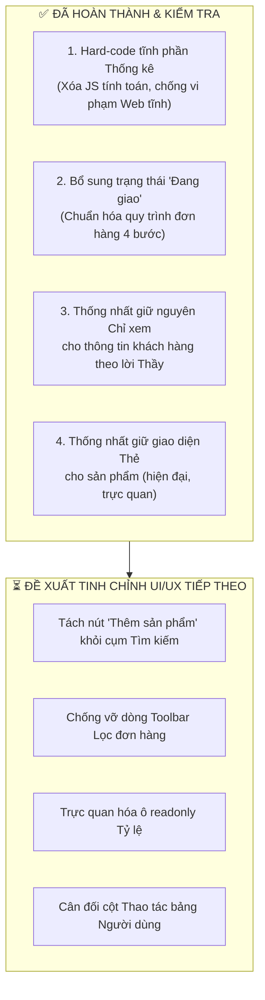

# BÁO CÁO TỔNG HỢP KIỂM TRA, CÁC LỖI ĐÃ SỬA & KẾ HOẠCH HOÀN THIỆN PHÂN HỆ QUẢN TRỊ (ADMIN)

> **Dự án:** Website bán hàng mô hình DVK Gunpla (Môn Web 1 - Đồ án Giao diện tĩnh)  
> **Nhánh thực hiện:** `admin`  
> **Căn cứ rà soát:**  
> 1. Bộ tiêu chí chấm điểm & cảnh báo trừ điểm ("lên thẹo"): [RULE.md](./RULE.md)  
> 2. Bộ tiêu chuẩn thiết kế Dashboard quản trị: **UI/UX Pro Max**  
> **Ngày lập báo cáo:** 04/11/2026

---

## 📌 TÓM TẮT TIẾN ĐỘ DÀNH CHO NHÓM

---

## I. CHI TIẾT CÁC VẤN ĐỀ ĐÃ SỬA (CHANGELOG)

### 1. Chuyển đổi phần Thống kê sang HTML tĩnh (Hard-code 100%)
* **Lý do sửa:** 
  * Trong [RULE.md](./RULE.md) (Lỗi 10), Thầy nhắc rất gắt: *"Website không được hoạt động thật dưới mọi hình thức, bấm lọc mà nó lọc được hay tính toán thật là lên thẹo"*.
  * Bản cũ để thẻ `<tbody id="st-body">` trống và dùng file JS chạy hàm `compute()` với các lệnh `.filter()`, `.reduce()` để tính toán mảng dữ liệu khi mở trang $\rightarrow$ Dễ bị Thầy phát hiện là viết code chạy thật.
* **Cách đã xử lý:**
  * Hard-code trực tiếp toàn bộ 4 thẻ KPI (Doanh thu `50.045.000đ`, 23 đơn hàng, 8 khách mua, Top 5 chiếm `90%`) và 5 hàng khách hàng Top 1 $\rightarrow$ Top 5 bằng HTML thuần vào `admin/statistics.html`.
  * Ở cột Đơn hàng, mỗi khách hàng có nút *"Xem danh sách đơn hàng"* liên kết sang `orders.html?user=...` (đúng chuẩn Lưu ý 8, tránh nhồi nhét mã đơn làm vỡ bảng).
  * Trong file `assets/js/admin/statistics.js`: Xóa sạch toàn bộ hàm tính toán `compute()`, chỉ giữ lại sự kiện click để hiện Toast thông báo giả lập *"Đã thống kê thành công"*, đảm bảo web tĩnh an toàn 100%.
* **Tệp đã chỉnh sửa:**
  * `admin/statistics.html`
  * `assets/js/admin/statistics.js`

---

### 2. Bổ sung trạng thái "Đang giao" cho Đơn hàng (Chuẩn hóa quy trình 4 bước)
* **Lý do sửa:**
  * Barem Mục II.4 dòng 94 quy định rõ các trạng thái đơn hàng: *(Chờ xác nhận, Đã xác nhận, **Đang giao**, Đã giao thành công, Đã hủy)*.
  * Bản cũ nhảy cóc từ `Đã xác nhận` sang `Đã giao thành công` luôn (bị thiếu bước Đang giao hàng).
* **Cách đã xử lý:**
  * Thêm trạng thái `shipping` (*"Đang giao"*) vào `ORDER_STATUS` trong `assets/js/data.js`. Quy trình chuyển trạng thái 1 chiều hoàn chỉnh:
    $$\text{Chưa xác nhận} \longrightarrow \text{Đã xác nhận} \longrightarrow \textbf{Đang giao} \longrightarrow \text{Đã giao thành công}$$
  * Bổ sung nút hành động *"Giao cho vận chuyển"* ở trang `admin/order-detail.html` thông qua `assets/js/admin/admin-layout.js`.
  * Cập nhật thanh tiến trình (`orderTimeline`) trong `assets/js/common.js` hiển thị đầy đủ 4 bước.
  * Thêm class màu nhãn `.chip-shipping` (nền xanh dương nhạt) trong `assets/css/style.css`.
  * Chuyển các đơn mẫu `DH26102506`, `DH26103002`, `DH26103105` sang trạng thái `shipping` để khi Thầy lọc danh sách đơn sẽ thấy có đơn đang giao thực tế.
  * Đồng bộ số liệu chờ xử lý / đang giao trên Dashboard `assets/js/admin/dashboard.js`.
* **Tệp đã chỉnh sửa:**
  * `assets/js/data.js`
  * `assets/js/common.js`
  * `assets/css/style.css`
  * `assets/js/admin/admin-layout.js`
  * `assets/js/admin/dashboard.js`

---

## II. GIẢI TRÌNH CÁC ĐIỂM NGHIỆP VỤ ĐẶC THÙ (THEO LỜI THẦY)

### 1. Về việc "Không làm form sửa thông tin khách hàng"
* **Thắc mắc:** Trong barem Mục II.2 có ghi *"Sửa thông tin khách hàng"*.
* **Giải trình:** Thầy đã đính chính trên lớp là **Admin không được phép sửa tên hay thông tin cá nhân của khách hàng** vì vi phạm quyền riêng tư và nghiệp vụ thực tế.
* **Quyết định:** Giữ nguyên trang `admin/user-form.html` ở chế độ **Chỉ xem (View-only)** để xem thông tin, mức chi tiêu và lịch sử đơn hàng của khách.

### 2. Về việc "Giữ nguyên giao diện dạng Thẻ cho Sản phẩm Admin"
* **Thắc mắc:** Trong barem ghi *"Hiển thị dạng bảng kèm hình ảnh"*.
* **Giải trình:** Giao diện lưới thẻ 4 cột hiện tại ở `admin/products.html` được thiết kế đồng bộ, có ảnh lớn, hiển thị đầy đủ chip trạng thái, tồn kho, đã bán và nút [Sửa] / [Ẩn] / [Xóa]. Giao diện này đẹp mắt và trực quan hơn bảng thô sơ, nhóm thống nhất giữ nguyên để không làm xáo trộn layout.

---

## III. ĐỀ XUẤT CÁC BƯỚC TINH CHỈNH TIẾP THEO (UI/UX PRO MAX)

Dưới đây là 4 tinh chỉnh nhỏ giúp giao diện chuẩn chỉ hơn nữa:

1. **Tách nút "Thêm sản phẩm" khỏi cụm Tìm kiếm:**
   * *Hiện tại:* Nút `[+ Thêm sản phẩm]` nằm chung cụm với `[Đặt lại]` và `[Tìm kiếm]` ở toolbar `admin/products.html`.
   * *Đề xuất:* Đưa nút `[+ Thêm sản phẩm]` lên góc trên bên phải trang để phân tách rõ ràng giữa hành động "Tạo mới" và hành động "Tìm kiếm".
2. **Chống vỡ dòng Toolbar Lọc Đơn hàng:**
   * *Hiện tại:* Thanh toolbar ở `admin/orders.html` có 6 ô lọc dễ bị rớt dòng lộn xộn khi mở trên màn hình nhỏ.
   * *Đề xuất:* Chia làm 2 hàng ngay ngắn (Hàng 1: Tìm kiếm + Nút bấm; Hàng 2: Các bộ lọc trạng thái, ngày tháng, địa điểm).
3. **Trực quan hóa ô readonly "Tỷ lệ" trong Form Sản phẩm:**
   * *Hiện tại:* Ô `pf-scale` trong `admin/product-form.html` bị `readonly` nhưng nền trắng giống ô nhập chữ bình thường.
   * *Đề xuất:* Thêm nền xám nhạt và ghi chú: *(Tự động chọn theo Phân loại)* để người dùng biết là không cần gõ tay.
4. **Cân đối cột Thao tác bảng Người dùng:**
   * *Hiện tại:* Nút "Xem" (icon tròn) và nút "Khóa" (hình chữ nhật có chữ) ở `admin/users.html` bị lệch kích thước.
   * *Đề xuất:* Chuyển nút Xem thành nút có chữ `[Xem chi tiết]` cho cân xứng tuyệt đối với nút `[Khóa tài khoản]`.

---

## IV. LƯU Ý KHI CHẠY THỬ & NỘP BÀI CHO THẦY
* Toàn bộ dự án đã được thiết lập đường dẫn tương đối (`data-root="../"`).
* Thầy sẽ chấm bằng cách **nhấp đúp trực tiếp vào file HTML trên Chrome** (đường dẫn `file:///D:/WEB/...`). Đảm bảo không mở qua Live Server khi nộp bài để khớp 100% môi trường chấm của Thầy.
