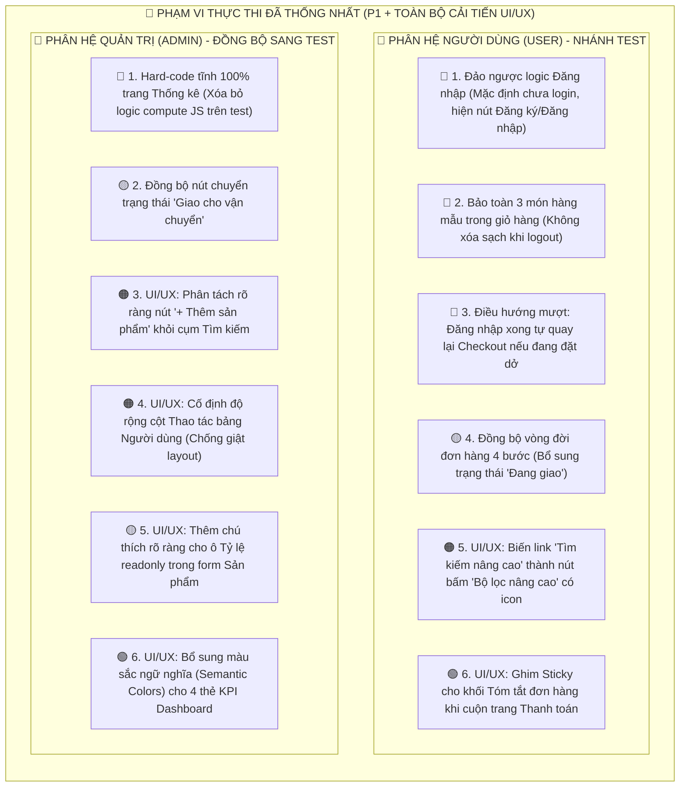

# BÁO CÁO TỔNG HỢP & KẾ HOẠCH SỬA LỖI TOÀN DIỆN (ADMIN & USER)

> **Dự án:** Website bán hàng mô hình DVK Gunpla (Môn Web 1 - Đồ án Giao diện tĩnh)  
> **Căn cứ rà soát:** [RULE.md](file:///D:/WEB/RULE.md) (Quy chế chấm điểm của Giảng viên) & Tiêu chuẩn thiết kế **UI/UX Pro Max**  
> **Quyết định thống nhất:** Triển khai sửa triệt để **Toàn bộ lỗi Rủi ro P1** kết hợp **Toàn bộ cải tiến UI/UX** đã đánh giá.  
> **Ngày cập nhật:** 05/11/2026  

---

---

# MỤC LỤC CHI TIẾT KẾ HOẠCH
1. [Phần 1: Chi tiết các sửa đổi Phân hệ Người dùng (User - Nhánh `test`)](#phần-1-chi-tiết-các-sửa-đổi-phân-hệ-người-dùng-user---nhánh-test)
2. [Phần 2: Chi tiết các tinh chỉnh Phân hệ Quản trị (Admin) đồng bộ sang `test`](#phần-2-chi-tiết-các-tinh-chỉnh-phân-hệ-quản-trị-admin-đồng-bộ-sang-test)
3. [Phần 3: Danh mục các tệp can thiệp và nội dung code cụ thể](#phần-3-danh-mục-các-tệp-can-thiệp-và-nội-dung-code-cụ-thể)
4. [Phần 4: Ma trận ưu tiên và trạng thái triển khai](#phần-4-ma-trận-ưu-tiên-và-trạng-thái-triển-khai)
5. [Phần 5: Hướng dẫn kiểm thử nghiệm thu trực tiếp (File:///)](#phần-5-hướng-dẫn-kiểm-thử-nghiệm-thu-trực-tiếp-file)

---

# PHẦN 1: CHI TIẾT CÁC SỬA ĐỔI PHÂN HỆ NGƯỜI DÙNG (USER - NHÁNH TEST)

### 1. 🔴 Sửa lỗi xác thực mặc định trên Header (Tránh bị Thầy trừ điểm nặng)
* **Vấn đề cốt lõi:**
  * File [assets/js/layout.js](file:///D:/WEB/assets/js/layout.js) dùng `sessionStorage.getItem("dvk_logged_out") !== "1"`. Khi Thầy nhấp đúp vào `index.html` lần đầu, cờ rỗng $\rightarrow$ Tự động coi là đã đăng nhập sẵn dưới tên *"Nguyễn Minh Anh"*.
  * Hậu quả: **Hai nút `[Đăng nhập]` và `[Đăng ký]` trên Header biến mất hoàn toàn**. Thầy chấm bài nhìn vào tưởng thiếu chức năng và trừ điểm theo barem [RULE.md](file:///D:/WEB/RULE.md).
* **Giải pháp triển khai:**
  * Chuyển sang cờ `sessionStorage.getItem("dvk_logged_in") === "1"`.
  * Mặc định khi Thầy mở trang chủ lên: Header **hiển thị rõ ràng 2 nút `[Đăng nhập]` và `[Đăng ký]`**.
  * Trong [pages/login.html](file:///D:/WEB/pages/login.html), khi bấm nút Đăng nhập: Gọi `setLoggedIn(true)` rồi mới chuyển trang.
  * Khi bấm Đăng xuất từ menu tài khoản: Xóa cờ đăng nhập và trả Header về trạng thái 2 nút ban đầu.

---

### 2. 🔴 Bảo toàn dữ liệu Giỏ hàng mẫu khi Đăng xuất (Chống lỗi Cart Wipeout)
* **Vấn đề cốt lõi:**
  * File [assets/js/layout.js](file:///D:/WEB/assets/js/layout.js) có dòng `if (!isLoggedIn()) SAMPLE_CART.length = 0;`. Khi Thầy bấm Đăng xuất để thử, giỏ hàng bị xóa sạch về `0`, nút *"Tiến hành đặt hàng"* bị disable $\rightarrow$ Thầy không thể bấm tiếp sang trang Thanh toán.
* **Giải pháp triển khai:**
  * Xóa bỏ hoàn toàn dòng lệnh xóa giỏ hàng. 3 sản phẩm mẫu trong giỏ luôn được giữ nguyên để Thầy có thể kiểm tra luồng đặt hàng và thanh toán bất kỳ lúc nào.

---

### 3. 🔴 Điều hướng thông minh khi đặt hàng (Smart Checkout Guard)
* **Vấn đề:** Khách chưa đăng nhập vào giỏ hàng bấm *"Tiến hành đặt hàng"* sẽ được đưa sang [pages/login.html](file:///D:/WEB/pages/login.html). Nếu sau khi đăng nhập xong mà đẩy về trang chủ thì khách phải vào lại giỏ hàng từ đầu.
* **Giải pháp:** Truyền tham số `?redirect=checkout` vào URL đăng nhập; sau khi đăng nhập thành công, hệ thống tự động đưa khách quay lại thẳng trang [pages/checkout.html](file:///D:/WEB/pages/checkout.html) để tiếp tục thanh toán.

---

### 4. 🟡 Chuẩn hóa quy trình Đơn hàng 4 bước (Bổ sung trạng thái "Đang giao")
* **Vấn đề:** Barem yêu cầu quy trình 4 bước: *(Chờ xác nhận $\rightarrow$ Đã xác nhận $\rightarrow$ **Đang giao** $\rightarrow$ Đã giao thành công)*. Nhánh `test` hiện tại mới có 3 bước.
* **Giải pháp:**
  * Bổ sung `shipping: { label: "Đang giao", badgeClass: "chip-shipping" }` vào `ORDER_STATUS` trong [assets/js/data.js](file:///D:/WEB/assets/js/data.js).
  * Mở rộng thanh `orderTimeline` trong [assets/js/common.js](file:///D:/WEB/assets/js/common.js) lên 4 nấc.
  * Thêm class màu nhãn `.chip-shipping` (nền xanh dương nhạt) và định dạng `.timeline` 4 cột trong [assets/css/style.css](file:///D:/WEB/assets/css/style.css).
  * Cập nhật các đơn mẫu sang trạng thái `shipping` để khách vào xem Lịch sử đơn hàng thấy rõ đơn đang giao.

---

### 5. 🟠 Cải tiến UI/UX Nút "Bộ lọc nâng cao" ([pages/products.html](file:///D:/WEB/pages/products.html))
* **Vấn đề:** Nút link `Tìm kiếm nâng cao` nằm chung một hàng với nhãn `Sắp xếp: [Mặc định]`, ngăn cách bởi một vạch kẻ mỏng `sort-sep`, trông giống như một thuộc tính sắp xếp hơn là tính năng lọc.
* **Giải pháp:** Thiết kế lại `#adv-link` thành một nút bấm nhỏ lịch sự `<a class="btn btn-outline btn-sm" href="advanced-search.html" id="adv-link">` có kèm icon tìm kiếm/bộ lọc, tách biệt rõ ràng với dropdown Sắp xếp.

---

### 6. 🟢 Cải tiến UI/UX Ghim Sticky Tóm tắt đơn hàng ([pages/checkout.html](file:///D:/WEB/pages/checkout.html))
* **Vấn đề:** Trang thanh toán có danh sách địa chỉ, hình thức giao hàng và mã QR chuyển khoản khá dài. Cột tóm tắt số tiền bên phải bị cuộn mất khỏi màn hình khi khách cuộn xuống dưới.
* **Giải pháp:** Bổ sung CSS `position: sticky; top: 96px;` cho cột tóm tắt đơn hàng (`aside.summary`) trên màn hình máy tính để người dùng luôn theo dõi được tổng tiền thanh toán khi đang điền thông tin.

---

# PHẦN 2: CHI TIẾT CÁC TINH CHỈNH PHÂN HỆ QUẢN TRỊ (ADMIN) ĐỒNG BỘ SANG TEST

### 1. 🔴 Chuyển Thống kê sang HTML tĩnh 100% (Phòng ngừa Thầy kiểm tra Admin trên nhánh test)
* **Giải pháp:**
  * Hard-code 4 thẻ KPI và bảng 5 khách hàng mua nhiều nhất trực tiếp vào [admin/statistics.html](file:///D:/WEB/admin/statistics.html).
  * Xóa sạch hàm `compute()` với `.filter()`, `.reduce()` trong [assets/js/admin/statistics.js](file:///D:/WEB/assets/js/admin/statistics.js).

### 2. 🟠 Phân tách nút "Thêm sản phẩm" ([admin/products.html](file:///D:/WEB/admin/products.html))
* **Giải pháp:** Thêm `margin-left: auto;` cho nút `[+ Thêm sản phẩm]` để tách biệt hành động Tạo mới khỏi cụm Tìm kiếm / Đặt lại của thanh filter.

### 3. 🟠 Cố định độ rộng cột Thao tác bảng Người dùng ([admin/users.html](file:///D:/WEB/admin/users.html))
* **Giải pháp:** Đặt `min-width: 175px` cho `.row-actions` trong [assets/css/admin.css](file:///D:/WEB/assets/css/admin.css) để khi bấm Khóa/Mở khóa bảng không bị co giãn giật layout.

### 4. 🟡 Thêm chú thích cho ô Tỷ lệ readonly ([admin/product-form.html](file:///D:/WEB/admin/product-form.html))
* **Giải pháp:** Thêm dòng chú thích nhỏ `(Tự động theo Phân loại)` bên cạnh nhãn "Tỷ lệ" để người dùng không thắc mắc vì sao ô bị khóa.

### 5. 🟢 Bổ sung Semantic Colors cho KPI Dashboard ([admin/index.html](file:///D:/WEB/admin/index.html))
* **Giải pháp:** Phối màu theo ngữ nghĩa chuẩn UI/UX Pro Max trong [assets/css/admin.css](file:///D:/WEB/assets/css/admin.css) và [assets/js/admin/dashboard.js](file:///D:/WEB/assets/js/admin/dashboard.js):
  * Doanh thu: Nền xanh lá dịu (`kpi-green`).
  * Đơn chờ xử lý: Nền xanh dương dịu (`kpi-blue`).
  * Khách hàng: Nền tím thanh lịch (`kpi-purple`).
  * Sản phẩm: Nền cam ấm (`kpi-amber`).

---

# PHẦN 3: DANH MỤC CÁC TỆP CAN THIỆP VÀ NỘI DUNG CODE CỤ THỂ

| Tệp tin | Phân hệ | Nội dung can thiệp |
| :--- | :--- | :--- |
| [assets/js/layout.js](file:///D:/WEB/assets/js/layout.js) | **User** | Đổi auth key sang `dvk_logged_in === '1'`, xóa bỏ dòng xóa cart, hỗ trợ lưu redirect param |
| [pages/login.html](file:///D:/WEB/pages/login.html) | **User** | Kích hoạt `setLoggedIn(true)` khi submit, tự động đưa khách về checkout nếu có `?redirect=checkout` |
| [assets/js/data.js](file:///D:/WEB/assets/js/data.js) | **Dùng chung** | Bổ sung `shipping` vào `ORDER_STATUS`, cập nhật đơn mẫu sang trạng thái `shipping` |
| [assets/js/common.js](file:///D:/WEB/assets/js/common.js) | **Dùng chung** | Cập nhật hàm `orderTimeline` vẽ đầy đủ 4 nấc tiến trình |
| [assets/css/style.css](file:///D:/WEB/assets/css/style.css) | **User** | Thêm class `.chip-shipping`, cập nhật `.timeline` 4 cột, thêm Sticky cho `.summary` ở Checkout |
| [pages/products.html](file:///D:/WEB/pages/products.html) | **User** | Nâng cấp nút `#adv-link` thành button xám có icon bộ lọc rõ ràng |
| [admin/statistics.html](file:///D:/WEB/admin/statistics.html) | **Admin** | Hard-code HTML tĩnh 4 thẻ KPI và bảng Top 5 khách hàng |
| [assets/js/admin/statistics.js](file:///D:/WEB/assets/js/admin/statistics.js) | **Admin** | Xóa bỏ toàn bộ hàm tính toán `compute()`, chỉ giữ toast giả lập web tĩnh |
| [admin/products.html](file:///D:/WEB/admin/products.html) | **Admin** | Phân tách nút `[+ Thêm sản phẩm]` |
| [admin/product-form.html](file:///D:/WEB/admin/product-form.html) | **Admin** | Bổ sung chú thích `(Tự động theo Phân loại)` cho ô Tỷ lệ |
| [assets/js/admin/dashboard.js](file:///D:/WEB/assets/js/admin/dashboard.js) | **Admin** | Thêm class màu ngữ nghĩa cho các ô KPI Dashboard |
| [assets/css/admin.css](file:///D:/WEB/assets/css/admin.css) | **Admin** | Thêm màu KPI `.kpi-green`, `.kpi-purple`, `.kpi-amber` và khóa độ rộng `.row-actions` |

---

# PHẦN 4: MA TRẬN ƯU TIÊN VÀ TRẠNG THÁI TRIỂN KHAI

| Mức độ | Phân hệ | Vấn đề đã xử lý / Kế hoạch | Trạng thái |
| :--- | :--- | :--- | :--- |
| **🔴 P1 (Khẩn cấp)** | **User** | Sửa logic đăng nhập mặc định làm ẩn 2 nút Header | Sẵn sàng thực thi code |
| **🔴 P1 (Khẩn cấp)** | **User** | Chống xóa sạch giỏ hàng khi đăng xuất | Sẵn sàng thực thi code |
| **🔴 P1 (Khẩn cấp)** | **User** | Đồng bộ trạng thái "Đang giao" (4 bước đơn hàng) | Sẵn sàng thực thi code |
| **🔴 P1 (Khẩn cấp)** | **Admin** | Hard-code tĩnh trang Thống kê (Chống vi phạm RULE.md) | Sẵn sàng thực thi code |
| **🟠 P2 (Nên sửa)** | **User** | Nâng cấp nút Tìm kiếm nâng cao thành button rõ ràng | Sẵn sàng thực thi code |
| **🟠 P2 (Nên sửa)** | **Admin** | Tách nút Thêm sản phẩm khỏi cụm tìm kiếm | Sẵn sàng thực thi code |
| **🟠 P2 (Nên sửa)** | **Admin** | Cố định độ rộng cột Thao tác bảng Người dùng | Sẵn sàng thực thi code |
| **🟡 P3 (Thẩm mỹ)** | **User** | Ghim Sticky tóm tắt đơn hàng khi cuộn trang thanh toán | Sẵn sàng thực thi code |
| **🟡 P3 (Thẩm mỹ)** | **Admin** | Chú thích ô Tỷ lệ readonly + Màu sắc KPI Dashboard | Sẵn sàng thực thi code |

---

# PHẦN 5: HƯỚNG DẪN KIỂM THỬ NGHIỆM THU TRỰC TIẾP (FILE:///)

Sau khi thực thi code, quá trình kiểm tra sẽ theo các bước sau:
1. **Kiểm tra Header ban đầu:** Nhấp đúp chuột mở trực tiếp `index.html`. Xác nhận trên Header hiển thị **2 nút rõ ràng: `[Đăng nhập]` và `[Đăng ký]`**.
2. **Kiểm tra Giỏ hàng mẫu:** Nhấp vào icon Giỏ hàng trên Header, xác nhận hiển thị sẵn **3 sản phẩm mẫu**, các nút số lượng và nút `"Tiến hành đặt hàng"` hoạt động bình thường.
3. **Kiểm tra Đăng nhập & Điều hướng:** 
   * Nhấp `"Tiến hành đặt hàng"`, hệ thống tự chuyển sang trang Đăng nhập.
   * Nhấp `"Đăng nhập"`, hệ thống lưu trạng thái và tự động quay lại trang Thanh toán [pages/checkout.html](file:///D:/WEB/pages/checkout.html).
   * Trên Header hiển thị avatar và lời chào *"Xin chào, Nguyễn Minh Anh"*.
4. **Kiểm tra Đơn hàng 4 bước:** Vào [pages/orders.html](file:///D:/WEB/pages/orders.html), xác nhận có đơn hàng ở trạng thái `Đang giao` và timeline 4 bước (`Chưa xác nhận` $\rightarrow$ `Đã xác nhận` $\rightarrow$ `Đang giao` $\rightarrow$ `Đã giao thành công`).
5. **Kiểm tra Sticky Checkout:** Cuộn trang thanh toán xuống dưới, khối tổng tiền bên phải luôn trôi theo tầm mắt.
6. **Kiểm tra Thống kê Admin:** Vào [admin/statistics.html](file:///D:/WEB/admin/statistics.html), xác nhận số liệu hiển thị sẵn bằng HTML tĩnh, không có hàm `compute()` chạy động.
